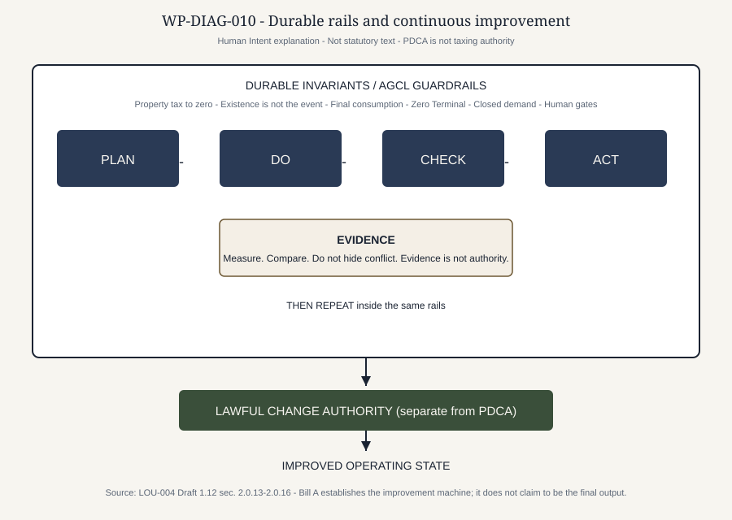
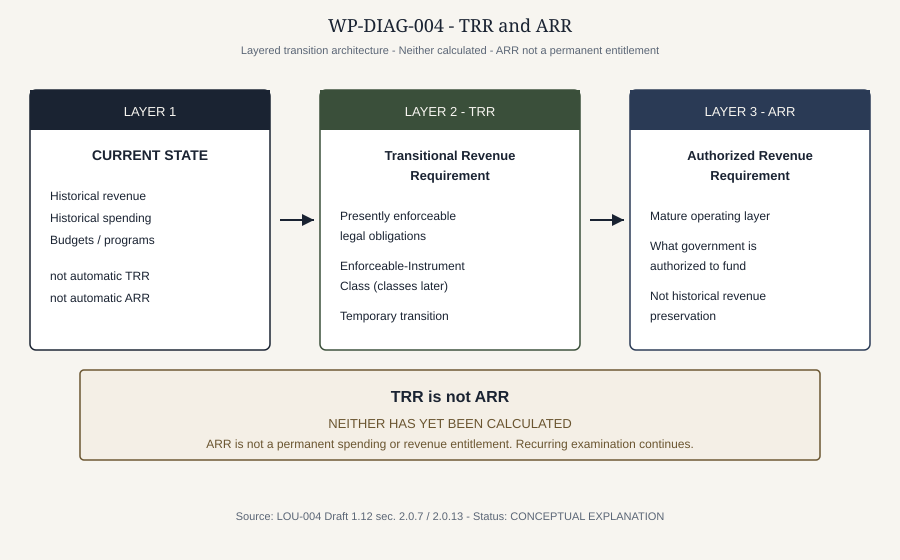
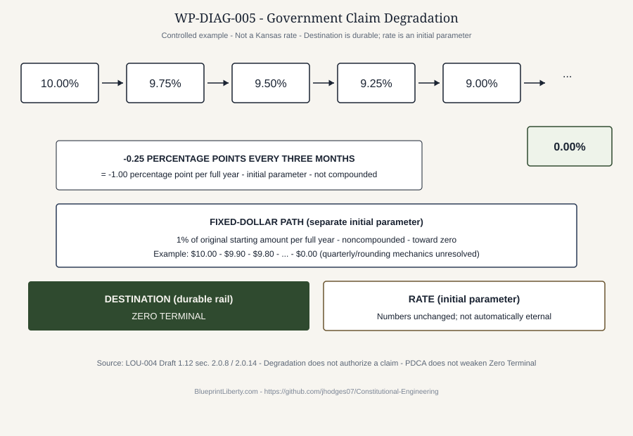
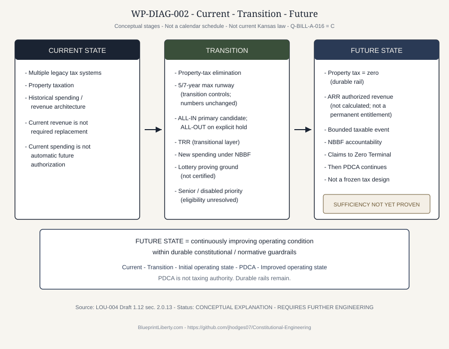

# BILL A: ENGINEERING A NEW KANSAS TAX SYSTEM

**Subtitle:** A Plain-Language White Paper Explaining LOU-004 Draft 1.12

```text
PUBLIC REVIEW DRAFT — FOR COMMENT
NOT FINAL
NOT HG-D1 ACCEPTED
NOT PROPOSED STATUTORY TEXT
```

**This white paper explains LOU-004 Draft 1.12.**  
**The LOU, not this white paper, is the controlling public-review expression of the current Human Engineering Intent.**

**Document class:** PUBLIC-REVIEW WHITE PAPER CANDIDATE  
**Version:** Draft 1.12  
**Derived from:** LOU-004 Draft 1.12 — PUBLIC REVIEW DRAFT CANDIDATE — NOT HUMAN-ACCEPTED  
**Governing work:** CWC-CE-175 (reconciled from CWC-CE-172 Draft 1.11 source to LOU-004 Draft 1.12 / Q-BILL-A-016 = C)  
**Assigned agent:** CE — Bill A Definition Engineer  
**Canonical repository SHA at drafting baseline:** `9eed44b47f2802a426106b4f3fb4b2d5b55be59a`  
**Status:** DERIVATIVE EXPLANATORY ARTIFACT — NOT SOURCE TRUTH — NOT LEGISLATIVE TEXT — NOT A SUBSTITUTE FOR THE CONTROLLED LOU  
**Bill A maturity:** 19% (unchanged)  
**Human Gate HG-D1:** NOT PASSED  
**Q-BILL-A-016:** C — INVARIANTS FIRST  

---

## Authority notice

This white paper explains Bill A LOU-004 Draft 1.12 in plain language. It is a derivative public-review document. It does not replace, amend, supersede, or constitute acceptance of LOU-004. Where this white paper and the controlled LOU differ, the controlled LOU governs. Matters identified by the LOU as unresolved remain unresolved.

LOU-004 Draft 1.12 is a **Public Review Draft candidate**. It is **not** Human-accepted. It is **not** a Final LOU. HG-D1 is **not** passed. Bill A maturity remains **19%**. This document is **not** enacted law, **not** introduced legislation, **not** proposed statutory text, **not** a specification, and **not** a claim that current Kansas statutes already operate this way.

Publication of these materials for comment, if later Human-authorized, would not validate Bill A and would not pass HG-D1.

Human silence is not acceptance.

**Project:** [BlueprintLiberty.com](https://BlueprintLiberty.com)  
**Repository:** [https://github.com/jhodges07/Constitutional-Engineering](https://github.com/jhodges07/Constitutional-Engineering)

---

## How to read this paper

Public review of Bill A is intended to move through layers:

1. a short landing README (when the later GitHub package exists);
2. this plain-language white paper;
3. the full controlled LOU-004 Draft 1.12;
4. the controlled engineering evidence beneath the LOU.

This paper sits in the middle. It is more explanatory than a landing page and easier to read than the full LOU. It is **not** engineering source truth. Controlled Human Intent and the controlled LOU govern. This paper explains them; it does not invent new Human Intent.

Throughout, when a technical term is necessary, it is defined in ordinary language the first time it appears.

Public review is requested so readers can expose incorrect assumptions, legal conflicts, fiscal weaknesses, implementation problems, contradictory requirements, unintended consequences, better alternatives, and missing evidence. Comment is not a vote that Bill A is finished.

---

## A. Why Bill A exists

Kansas taxpayers already live inside a tax system. Money is collected through many channels: property taxes, sales and use taxes, income and payroll taxes, fees, licenses, assessments, Lottery receipts, and other governmental inflows. Agencies, counties, cities, school districts, and other governmental bodies spend that money on functions that matter: schools, roads, public safety, courts, health, and more.

Bill A begins from a harder question than “how do we raise the same amount of money by a different method?”

The harder question is:

**How should government obtain authority to take money from people, for what event, for how long, into what pool, for what authorized purpose, under what measurable accountability, and with what path toward ending a claim that no longer should continue?**

Under the controlled Human Intent recorded in LOU-004, Bill A rejects two assumptions that often quietly shape tax debates:

**Current tax revenue is not automatically required replacement revenue.**

**Current spending is not automatically authorized future spending.**

**Current revenue claim is not automatically future authority.**

Those sentences matter. If today’s collections are treated as a permanent entitlement, then every reform becomes a shell game: rename the tax, move the collector, keep the same claim forever. If today’s spending is treated as self-justifying, then historical existence becomes a permanent future mandate.

Bill A is intended to break that loop. It is an attempt to engineer a replacement Kansas tax architecture around property rights, clear signals before claims, a bounded taxable event, temporary transition protections, spending accountability, and compulsory claims that can terminate.

This is Bill A Human Intent and working Definition. It is **not** a claim that current Kansas law already works this way.

### Why Kansas taxpayers should care before rates exist

Many people will ask a natural first question: what will my rate be? Bill A refuses to answer that question first, and that refusal is intentional. A rate without an architecture is a number floating over a broken machine. If the machine still treats current collections as permanent entitlement, still treats current spending as self-authorizing, and still treats compulsory claims as immortal by default, then a new rate is only a new costume.

Bill A asks Kansans to inspect the machine first: who has the property right before pooling; what signal must appear before a claim; what event authorizes the claim; how long may the claim survive; what spending is actually authorized; what happens when government fails; and how a claim ends. Only after those questions are engineered can rates, distributions, and statutory text be more than improvisation. That sequencing is why this white paper spends more time on architecture than on dollar forecasts.

Bill A is also not an attempt to freeze the first operating design as if it were already the permanently perfect tax system. Under the Human decision recorded as **Q-BILL-A-016 = C — Invariants First**, Bill A is intended to establish a lawful architecture that can begin operating realistically and then improve through evidence, without silently erasing the guardrails.

---

## The improvement machine

The controlling Human-Intent formulation, explained here and not converted into statutory meaning by this paper, is:

**Bill A establishes the improvement machine. It does not claim to be the final output of the machine.**

That sentence is the difference between a tax code that pretends enactment day was perfection and a tax architecture that can become better two years later without becoming less constitutional, less transparent, less bounded, or less protective of taxpayer rights.

The intended sequence is:

durable guardrails  
→ an initial lawful operating architecture  
→ Plan  
→ Do  
→ Check  
→ Act  
→ an improved operating state  
→ repeat.

Every step remains subject to the authority legally required for that particular change. **Plan-Do-Check-Act (PDCA)** is the continuous-improvement loop. PDCA is **not** taxing authority. PDCA is **not** automatic administrative power to rewrite taxation. PDCA is **not** a license to expand government merely because someone can measure a dashboard.

A useful picture of time, not a statutory calendar, is:

Current State  
→ Transition  
→ Initial operating state  
→ PDCA  
→ Improved operating state  
→ PDCA  
→ Further improved operating state.

**Future State**, in Draft 1.12, means a continuously improving operating condition within durable constitutional and normative guardrails. It does **not** mean a permanently frozen tax design created by the original bill.



### Rails that stay

Q-BILL-A-016 = C keeps six items durable until they are separately reopened through controlled authority. They are rails, not ordinary operating knobs:

1. **Property tax goes to zero statewide.**
2. **Existence is not the intended taxable event.**
3. **The H.R. 25-style economic standard is final consumption.**
4. **Zero Terminal is the destination for claims actually subject to Government Claim Degradation.**
5. **Post-Bill-A compulsory demand authority is closed.**
6. **Human gates remain Human gates.**

This paper does not add a seventh rail of that class. Other already-controlled principles remain Human Intent—property rights precede pooling; signal must precede claim; current revenue is not required replacement revenue; current spending is not automatic future spending; current claims are not automatic future authority; accountability without consequences is only reporting; failure must produce a signal and a response. Those principles were not newly numbered as Q-016 rails merely because this draft explains continuous improvement.

### Settings that can improve

Some currently recorded numbers are easy to mistake for eternal law merely because they contain digits. Under Q-BILL-A-016 = C they are **not** automatically durable invariants. They are initial parameters, hypotheses, transition controls, or pilots. The currently recorded values are **not changed** by this paper. Adjustment later requires the applicable lawful change authority. Evidence can show that a setting should change. Evidence does not, by itself, authorize the change.

In ordinary language, and using the Draft 1.12 labels without turning this paper into a control table:

- **CLASS I** — a durable invariant: a rail that ordinary improvement evidence cannot silently move;
- **CLASS P** — a parameter: a measurable operating setting that may later be a candidate for adjustment through the legally required authority;
- **CLASS HYP** — a hypothesis: an engineering proposition that still needs evidence (this is **not** the older “CLASS H” public-review fork label, and it is **not** Human Gate HG-D1);
- **CLASS T** — a transition control: a temporary mechanism used to move from Current State toward a better operating condition;
- **CLASS PILOT** — a bounded proving ground intended to produce evidence before broader deployment;
- **CLASS U** — unresolved: there is not yet enough Human Intent, evidence, or authority to classify safely.

Named numbers preserved unchanged as initial recorded Human-Intent values include: the **up to 5% state** and **up to 5% local** planning ceilings; the **5-year** and **7-year** property-tax maximum runways; the **four-month** NBBF accountability cadence; Government Claim Degradation of **0.25 percentage points every three months** and **1% of the original fixed-dollar amount per full year**; Lottery **4%** post-prize Rule-of-72 partition; Lottery **90/10** engineering target; and Lottery **50/50** identified-purchaser and anonymous attribution. Those numbers are explained again in the sections that use them. None of them is recast here as a guaranteed rate, a certified result, or an eternal invariant merely because it is a number.

### Who may change what

The intended chain is:

measurement  
→ recommendation  
→ required change authority  
→ authorized change  
→ a recorded, traceable new value  
→ measure again.

This paper does **not** invent the final list of which later changes may be made by controlled administration, statute, the legislature, Human Engineering authority, constitutional change, or another lawful mechanism. That matrix remains later engineering. The important public point is simpler: a better dashboard reading is not a secret tax rewrite.

Improvement may change the machine. Improvement may not silently remove the guardrails.

---

## B. Property rights before pooling

Most people encounter tax as a bill, a withholding line, or a price at the register. Bill A asks them to start one step earlier.

Before government pools money, there is a person with economic resources and a property right in those resources. Government may, under lawful authority, make a bounded claim. But under Bill A’s controlling principles, **property rights precede government pooling**.

That order is not a slogan for smaller government by rhetoric. It is an engineering starting point. If pooling comes first in the mental model, then government need begins to look like a property right, taxpayers begin to look like residual backstops, and accountability becomes optional reporting after the money is already gone.

Bill A begins with the taxpayer rather than the tax agency because the agency is a steward of a claim, not the creator of the underlying economic resource.

Taxpayer ownership and government stewardship remain engineering objectives. What happens to legal ownership and custody after payment—exact downstream mechanics—remains unresolved in the controlled LOU and is marked as later legal/engineering work. This paper does not invent that answer. An unresolved legal objective is not a current-law fact.

---

## C. Signal must precede claim

Bill A’s second foundational principle is:

**Signal must precede claim.**

In ordinary language: government should not be able to take money first and explain itself later. A compulsory monetary claim is supposed to follow a clear government signal that identifies, among other things:

- the authority for the claim;
- the taxable event;
- the obligated party;
- the timing;
- how the amount is determined;
- where the money goes;
- the limits of the claim;
- and, where applicable, how the claim expires or is reconsidered.

This is the Bill A meaning of “signal precedes claim.” It is an intended architectural requirement, not a claim that every current Kansas tax instrument already satisfies it.

If signal does not precede claim, people cannot evaluate whether a demand is lawful, bounded, temporary, or permanent. Accountability collapses into after-the-fact complaint.

---

## D. The ultimate economic source

Bill A records a controlled economic principle:

**There is one ultimate source of taxation: people with money.**

Businesses, corporations, employers, retailers, landlords, and other organizations can collect, transmit, withhold, account for, or shift the practical burden of a tax. Those roles matter. They do not, under Bill A’s Human Intent, create a separate ultimate source of economic resources merely by moving money around.

The LOU captures the idea in a blunt line:

**Shuffling the deck does not create another tax source.**

Governmental labels and collection mechanisms do not create another ultimate economic source.

This is a controlled Bill A economic principle and Human Intent. It is **not** presented here as universal academic consensus, and it is **not** presented as current Kansas statutory doctrine. It is the principle Bill A uses to keep reform from pretending that renaming collectors creates new wealth.

If a county, city, school district, or agency needs money, the ultimate economic source remains people with economic resources. Intermediaries may be part of administration. They are not a second origin of money.

---

## E. Tax the event, not existence

For the state’s intended consumption-tax architecture, Bill A looks to the substantive economic standard of current H.R. 25 (119th Congress), the FairTax Act of 2025, as a selected federal reference, adapted to Kansas only as necessary without silently changing that selected economic standard. Under Q-BILL-A-016 = C, that **economic standard of final consumption** is a durable rail. H.R. 25 **implementation mechanisms**—administration, exemptions, statutory text—remain later research. They are not thereby made durable merely because the economic standard is durable.

Two distinctions must stay clear:

1. **H.R. 25** is a federal architecture and bill text.
2. **Bill A** is a Kansas engineering project that uses that substantive economic standard as Human-selected direction, with Kansas adaptation still requiring later engineering.

Bill A does **not** claim that Kansas statutory language has already been drafted. Exact H.R. 25 crosswalk work remains incomplete and is disclosed as such.

Under the controlled Bill A direction for the H.R. 25-style architecture, mere existence or ownership is not itself the intended taxable event. That rule is a durable rail under Q-BILL-A-016 = C. In plain language:

- merely owning property is not the intended taxable event;
- merely possessing savings is not the intended taxable event;
- merely accumulating capital is not the intended taxable event;
- appreciation by itself is not the intended taxable event;
- income merely earned or received is not the intended state H.R. 25-style taxable event;
- merely owning land, real property, personal property, or investments is not itself the intended taxable event.

The intended taxable-event architecture is **final consumption**, including previously defined treatment of business and investment purpose, resale and production, used property, mixed use, and gaming where that treatment already exists in the controlled H.R. 25 crosswalk. This white paper does not invent Kansas statutory language, exemptions, rates, or administrative machinery.

Rates are **not set**.

Kansas state-level legacy tax architecture is intended to convert to that H.R. 25-style consumption-tax architecture. The state is not intended to keep a parallel traditional state income/payroll system merely because one exists today. Exact rates, administration, exemptions, distributions, and statutory mechanisms remain later work.

Provisional **planning ceilings** remain part of active Human Intent: **up to 5% state** and **up to 5% local**. These are planning ceilings. They are not targets, entitlements, final rates, certified sufficient rates, or operative statutory rates. Under Q-BILL-A-016 = C they are **initial operating parameters**, not durable rails. The currently recorded numbers are **not changed** by this paper. If later controlled evidence shows a different ceiling should be considered, that evidence goes to the authority legally required to change it. The engineering objective is the **lowest sufficient authorized rate**. Rates are not calculated here. Five percent plus five percent is not a guaranteed ten percent.

A **local revenue envelope** is not county-government ownership. Authorized local revenue may support legitimate functions performed by USDs, counties, cities, townships, special districts, or other authorized entities. Money is intended to follow legitimate authorized function, not historical levying entity. Distribution percentages are not established here.

After Bill A, compulsory demand authority is intended to be **closed**. That closed-authority rule is a durable rail. PDCA cannot reopen a new compulsory claim merely because evidence suggests government would like more money.

A historical ALL-OUT county income/payroll path split was recorded earlier in Definition work. That path is **not** current active architecture. ALL-OUT is on explicit hold, as explained below. That hold is not a silent repeal of the “existence is not the event” rule for the H.R. 25-style architecture.

---

## F. Property tax to zero

One of Bill A’s clearest Human Intent statements is also one of its most consequential:

**Property tax goes to zero statewide.**

Every Kansas county eliminates property taxation. This is not a local optional courtesy. Under Q-BILL-A-016 = C, statewide zero is a **durable rail**. Ordinary improvement evidence cannot silently restore property tax or convert “zero” into “almost zero.”

Each county independently selects a **5-year maximum runway** or a **7-year maximum runway**. Those are maximums, not guaranteed continued collection periods. Under Q-BILL-A-016 = C they are **current transition controls / initial parameters**, not a claim that five and seven are eternally perfect numbers. The currently recorded maxima are **not changed** by this paper. Lengthening or shortening them later requires the applicable lawful change authority. If sufficient authorized replacement revenue exists earlier under the active architecture, remaining property-tax requirements may be eliminated earlier, subject to protected obligations and later fiscal engineering.

This paper does **not** calculate transition amounts, mill-rate paths, or sufficiency tests.

Priority under Human Intent:

1. qualifying senior homeowners first;
2. qualifying disabled persons on fixed incomes also priority, for a qualifying principal residence;
3. then remaining property taxpayers.

Age, disability qualification, fixed-income definition, residency, principal-residence definition, trusts, joint ownership, surviving spouses, special assessments, and financing mechanics remain **unresolved**. This paper does not invent eligibility rules.


---

## G. County decisions under current active architecture

Counties still face a property-tax **runway** decision: 5-year maximum or 7-year maximum. That decision is about transition timing. It is not a veto over elimination.

**ALL-IN / ALL-OUT does not determine whether property tax disappears.**

**Property tax goes to zero in every Kansas county.**

ALL-IN and ALL-OUT once appeared in public explanation as two coequal current implementation paths. That reading is **stale**.

Current status under LOU-004 Draft 1.12:

**ALL-IN** is the **primary active candidate**. It is **not** Human-accepted.

**ALL-OUT** is a **deferred candidate** on **explicit hold**. It is **not retired**. It is **not active**. It is **not** a current coequal Bill A path. ALL-OUT engineering is not resumed in this paper.


---

## H. ALL-IN — primary active candidate

An ALL-IN county participates in the new Bill A state/local architecture.

Conceptually:

- the county joins the replacement architecture rather than clinging to permanent legacy local taxation;
- **TRANSITION** uses a controlled transitional layer called TRR;
- **ACTIVE / ACCOUNTABILITY** uses NBBF-admitted spending and functions;
- later operating years use a mature authorized-revenue concept called ARR, which remains subject to lawful recurring examination under the continuous-improvement architecture and is **not** a permanent spending or revenue entitlement;
- all **new spending** is immediately subject to NBBF;
- revenue above the controlled transition requirement or projection can accelerate remaining property-tax elimination;
- “no double dip” is preserved as a principle: transition is not supposed to let government collect overlapping claims as if both old and new systems were permanent entitlements.

ALL-IN does **not** mean “whatever we collect today becomes forever.” Historical revenue is not a permanent entitlement. Exact fiscal mechanics are **not complete**. Rates and replacement formulas are **not calculated**. ALL-IN is **not** Human-accepted.

---

## I. ALL-OUT — explicit hold, not an active path

ALL-OUT is **not** presented here as a current implementation choice sitting beside ALL-IN.

Q-BILL-A-011 was answered **C — Defer with explicit hold.** Active Definition does not depend on ALL-OUT surviving. This paper does not continue ALL-OUT engineering.

Historical design work is preserved only so readers can see how the architecture evolved. Historically, ALL-OUT meant a county would not participate in the new **local** H.R. 25-style replacement architecture and would receive **no** Bill A replacement-revenue guarantee, while property tax still went to zero and statewide taxpayer-control architecture still applied. That historical description is **on hold**. It is not current active architecture.

If a reader encounters older Bill A materials that treat ALL-OUT as a live coequal path, those materials are superseded by LOU-004 Draft 1.12.

County nexus notes that were recorded for historical ALL-OUT income/payroll design are likewise **not** current active architecture. They remain research-open if ALL-OUT is later released from hold. This paper does not invent nexus rules.

---

## J. TRR — Transitional Revenue Requirement

During transition, Bill A uses a layered model:

- **Layer 1 — Current State**
- **Layer 2 — TRR (Transitional Revenue Requirement)**
- **Layer 3 — ARR (Authorized Revenue Requirement)**

TRR is the temporary transition layer. Its purpose is continuity for qualifying presently enforceable transition obligations—not preservation of every historical budget line as a permanent right.

Under the controlled Human decision (Q-BILL-A-008 = B), TRR uses an **Enforceable-Instrument Class** approach. In plain language:

A TRR candidate must arise from a **presently enforceable legal obligation** belonging to a qualifying class that will later be established through controlled evidence and legal research.

That means the following are **not** automatically TRR merely because they exist:

- historical spending;
- budgeted spending;
- appropriated spending;
- program existence;
- agency existence;
- staffing;
- current revenue;
- legal existence of a government body;
- pre-existing government activity.

Enforceable-Instrument Class is the gate. The final list of qualifying legal classes is **not** determined yet. TRR has **not** been calculated.

During transition, protected qualifying current obligations may enter TRR analysis. **New spending** is intended to face NBBF. The transition is not supposed to automatically grandfather new spending into protected status.

---

## K. ARR — Authorized Revenue Requirement

ARR is the mature authorized-revenue concept inside Future State.

If TRR asks, “What presently enforceable obligations must be protected while we transition?”, ARR asks a different question:

**After transition engineering, what is government actually authorized and required to fund?**

Those are not the same question.

**TRR ≠ ARR.**

TRR does not automatically become ARR. Historical revenue preservation is not ARR. ARR does **not** silently become a permanent spending or revenue entitlement merely because it is the later operating layer. Under Q-BILL-A-016 = C, ARR remains subject to lawful recurring examination as the operating condition improves. Neither TRR nor ARR has been calculated. This paper does not invent dollar amounts, rates, or county allocations.



TRR is a transition tool. ARR is later authorized-revenue engineering inside a continuously improving Future State. Current spending is not automatic TRR. Historical spending is not automatic ARR. ARR is not a permanent entitlement.

---

## L. NBBF — spending must earn continued authority

**NBBF** means **Node-Based Budgeting Framework**. In Bill A’s plain-language purpose, it is the candidate accountability architecture for authorized governmental functions: a shift away from

collect money → fund program → review much later

toward:

authorized function → money → node → performance → signal → controlled response.

A “node” is a defined unit of responsibility: a place where a function, money, evidence, and accountability can be connected. Exact Kansas/Bill A admission procedures and final enforcement mechanics are **not invented** yet.

Where supported by the controlled architecture, Bill A retains a high-level Human Intent of roughly **four-month** node accountability. That interval is the **current initial Human-Intent cadence**. It is **not** automatically an eternal invariant under Q-BILL-A-016 = C. The currently recorded four months are **not changed** by this paper. A later evidence-based change to the interval requires the applicable lawful change authority. The durable principle is simpler than the interval: **government performance must be checked**, and **failure must produce a controlled signal and a controlled response**. NBBF does **not** possess taxing or legislative authority. The detailed mechanics are not invented here. Unresolved NBBF consequences have **not** already been legally engineered.

One principle is stated plainly:

**Accountability without consequences is only reporting.**

**Failure must produce a controlled signal and a controlled response.**

If a node fails, the architecture is intended to produce a controlled signal and a controlled response—not merely a PDF that nobody acts on. Exact response ladders remain later engineering.

All **new spending** is immediately subject to NBBF under controlled Intent, including new transition instruments.

NBBF performance does **not** create cash. Telemetry of NBBF results is not itself available governmental money.

---

## M. Kansas Lottery — a major Bill A component

The Kansas Lottery is a **major Bill A component** and a candidate **Phase-One proving ground**.

Under Q-BILL-A-016 = C, the Lottery is also an example of a bounded proving-ground pattern:

bound  
→ operate  
→ measure  
→ compare  
→ correct  
→ prove  
→ expand only through lawful authority.

This paper does **not** authorize expansion of the Lottery architecture into unrelated Bill A mechanisms. The Lottery is not controlling authority for the rest of the tax system.

Human Intent characterizes Lottery participation, under Bill A architecture, as a candidate **voluntary tax**: a person may choose whether to buy a ticket, while the governmental portion of that economic transaction is being engineered as part of Bill A’s revenue and accountability architecture.

That phrase is **Human Engineering Intent**. It is **not** a finding about the Lottery’s current legal classification. This paper does not convert a Lottery purchase into a Kansas FairTax taxable event merely by using that characterization.

The Lottery is being considered useful for testing, in one measurable stream:

- a voluntary transaction;
- a measurable purchase;
- a prize obligation;
- a cash waterfall;
- taxpayer attribution;
- geographic attribution;
- a Rule-of-72 partition;
- governmental cash;
- NBBF;
- taxpayer telemetry;
- property-tax transition.

No operational implementation is claimed. No certified Lottery fiscal result is claimed.

A Round 2 Lottery research PDF was expected in the controlled Cursor workspace. It was **not found**. Full ingestion is **blocked**. This paper does not reconstruct it and does not treat unsupported Round 2 assertions as controlled facts.

---

## N. Lottery cash waterfall, Rule-of-72, and 90/10

The controlled Human-Intent architecture is:

```text
GROSS LOTTERY CASH RECEIPTS
→ PRIZE OBLIGATIONS
→ POST-PRIZE CASH
→ 4% RULE-OF-72 INDIVIDUAL PARTITION
→ EVIDENCED UNAVOIDABLE DIRECT ECONOMIC COSTS
→ 90/10 ENGINEERING BASE
→ AVAILABLE GOVERNMENTAL CASH
  versus
  CONTROLLABLE ADMINISTRATION
→ AVAILABLE GOVERNMENTAL CASH
→ PROPERTY-TAX ABATEMENT / RETIREMENT.
```

This is a **definition architecture**. It is **not** a certified fiscal result.


### Rule-of-72 partition

The current Human planning concept is **4% of post-prize revenue**.

That 4% is the currently recorded **initial planning parameter**. It is **not** automatically a durable invariant merely because it is a number. The currently recorded 4% is **not changed** by this paper. Adjustment later requires the applicable lawful change authority.

It is **not** 4% of gross ticket sales. It is **not** a current Kansas Lottery rule. It is **not** an enacted rate. It is **not** a final statutory percentage. An earlier gross-ticket model of five cents per dollar of gross ticket sales is **superseded**.

The transaction-generated Rule-of-72 partition is **not** an NBBF clawback.

Ownership, custody, investment instrument, public-debt instrument, tax treatment, inheritance, liquidity, and final legal structure remain unresolved. Hypothetical investment returns are not guaranteed.

### 90/10 engineering target

The **90/10 base** is:

post-prize cash  
minus the 4% Rule-of-72 partition  
minus evidenced unavoidable direct economic costs.

The **90 side** is **available governmental cash**.

The **10 side** is a **ceiling / not a spending entitlement** for controllable administration.

If lawful, secure, reliable operation can be achieved below 10%, Bill A’s Human Intent is **not** to spend additional money merely to reach 10%. Lowest practicable controllable cost is the objective.

**90/10 feasibility is not certified.** Ninety percent is not a finding about current Kansas Lottery economics, not a statutory percentage, not a guaranteed result, and not 90% of gross sales. The 90/10 split is an **engineering target / initial parameter**, not a certified operating result and not an eternal invariant. The currently recorded 90/10 values are **not changed** by this paper.

### Cost discipline

Current cost is not a future cost entitlement. An engineering target is not permission to ignore real cost.

Later evidence must distinguish **unavoidable direct economic cost** from **controllable administration**. Retailer compensation is **classification required**. This paper classifies no unsupported current Lottery cost as either unavoidable or controllable. If later evidence shows the 90/10 target is unachievable, the conflict is to be reported—not hidden by manipulating the denominator.

That Lottery discipline is now a Bill-A-wide evidence rule. An engineering target plus contrary controlled evidence produces a conflict signal. The architecture is then supposed to refuse false certification, conduct controlled review, and retain, modify, replace, retire, or defer the hypothesis through the applicable change authority.

**A failed hypothesis is information. It is not permission to manipulate the measurement.** Evidence shall not be manipulated to protect an engineering target.

### Available governmental cash

Cash received is not automatically cash available. A receipt may be owed, restricted, encumbered, protected, or required for another legitimate prior claim. A bank balance is not automatically available revenue.

The 90 side must ultimately reconcile to auditable monetary flows. The following **cannot** count as available governmental cash:

- telemetry;
- NBBF performance;
- projected savings;
- accounting credits;
- Rule-of-72 account value;
- noncash public benefit.

Debt proceeds are not free revenue.

### Property-tax destination

Remaining **available governmental Lottery cash** is intended **primarily** for **property-tax abatement / retirement**, subject to later-identified legally required obligations Bill A cannot impair.

That is an **engineering objective**. It is **not** an appropriation, a current-law rule, a certified dollar amount, proof that Lottery revenue can replace property taxes, or a final disposition of current Lottery beneficiaries. Abatement versus retirement ranking remains deferred.

---

## O. Lottery geography, attribution, and current beneficiaries

For an **identified Kansas purchaser**, Human Intent currently attributes available governmental Lottery cash:

- 50% to the county of sale;
- 50% to the purchaser’s domicile county.

Those 50/50 values are currently recorded **initial parameters**. They are **not** automatically immutable. The currently recorded values are **not changed** by this paper.

If those are the same county, effective attribution is 100% to that county.

For an **anonymous / unregistered** purchase:

- 50% to the county of sale;
- 50% to a Kansas **105-County Fund**.

The 105-County Fund distribution formula remains **unresolved**. Identified **non-Kansas** purchaser treatment remains **unresolved**. This paper does not invent those rules.

**County attribution is not county-government ownership.** Geographic attribution identifies the relationship of governmental cash to the transaction and geography. It does not automatically grant unrestricted spending authority to a county government. Money is still intended to follow legitimate authorized function.

**Current statutory destination is not an automatic Future-State entitlement.**  
**Current statutory destination is also not automatically available cash.**

Current Lottery beneficiary obligations require a controlled legal and evidence audit. This paper does **not** say which current beneficiary retains or loses funding.

---

## P. Government Claim Degradation

Bill A rejects the presumption that an authorized compulsory government claim is permanent merely because it was once authorized.

**Government Claim Degradation (GCD)** means: authorized compulsory governmental monetary claims **subject to the rule** must contain and follow an authorized path that reduces the claim over time toward **Zero Terminal**, unless a separately established exception applies.

Two ideas must stay separate:

- **GCD destination** is Zero Terminal for claims actually subject to the rule. That destination is a durable rail.
- **GCD rate** is how fast a subject claim currently degrades. The currently recorded numerical rates are **initial parameters**. They are **not** the invariant. They are **not changed** by this paper. They are also **not** automatically adjustable by an administrator merely because a dashboard prefers a different slope.

Important firewalls:

- **Substance controls over label.** Renaming a claim as a tax, fee, assessment, levy, surcharge, license, permit, contribution, or service charge does not evade the rule when the underlying substance remains a compulsory government claim.
- **Degradation does not authorize a claim.** Authorization must come first. GCD is not a backdoor to invent new taxes.

This paper does not silently extend GCD to claims or contexts not covered by the controlled record. Because ALL-OUT is on explicit hold, historical ALL-OUT income/payroll GCD is **not** current active architecture.

### Percentage path (controlled, where GCD applies)

Minus **0.25 percentage points** every three months, which is **1.00 percentage point per full year**. That numerical rate remains the currently recorded initial Human-Intent parameter. It is **not** recast as an eternal invariant. The number is **not changed** here.

**Example (illustration only, not a Kansas rate):**

10.00% → 9.75% → 9.50% → 9.25% → 9.00% → … → 0.00%

This is not proportional reduction. It is not compounded percentage-of-remaining-rate math. Where annual liability is calculated across quarterly degrading percentage rates, the controlled concept uses the **arithmetic average** of applicable rates. Partial-year and implementation mechanics remain unresolved.

### Fixed-dollar path (controlled, where GCD applies)

For fixed-dollar compulsory claims subject to the rule: **1% of the original starting amount per full year**, noncompounded, toward zero. That numerical rate likewise remains the currently recorded initial parameter. It is **not changed** here. It is **not** Zero Terminal itself.

**Example (illustration only):**

$10.00 → $9.90 → $9.80 → $9.70 → … → $0.00

Quarterly implementation, rounding, fractional cents, and the last collectible increment remain unresolved.

### Narrow jury-decision exception

A monetary claim arising from a **court decision by a jury** is outside the general GCD requirement. That exception is narrow. This paper does not broaden it.



---

## Q. Zero Terminal

**Zero Terminal** is the general destination for claims subject to Government Claim Degradation. Under Q-BILL-A-016 = C, that destination is a **durable rail** for claims actually subject to GCD. The destination is not weakened merely because the degradation *rate* is later treated as an adjustable parameter.

In plain language: those claims are intended to terminate at zero. There is no automatic permanent non-zero floor.

This changes the presumption from:

“government claim continues until someone manages to repeal it”

toward:

“government must operate in an architecture where compulsory claims have an authorized path toward termination.”

That is Human Intent for Bill A. It is **not** current Kansas law.

Government may not evade Zero Terminal merely by renaming or reclassifying the claim.

Some readers will ask whether Zero Terminal is anti-democratic because it makes claims expire. Bill A’s answer is architectural, not anti-electoral. Legislatures and voters can still authorize claims. The point is that authorization should not silently become immortality. If a claim should continue, the architecture is supposed to force that continuation to be re-earned through lawful authorization and clear signal—not through inertia, renaming, or budget habit.

That is a contestable Intent. It is also a clear Intent.

---

## R. Sinking funds and the long-term idea

Bill A records a Future-State objective involving sinking funds. Two tracks must remain distinct:

- **personal / individual Rule-of-72 sinking accounts**
- **governmental sinking funds**

The conceptual objective is that authorized capital accumulation and authorized earnings may, over time, increasingly support authorized functions as compulsory claims degrade toward zero.

This paper states clearly what that objective is **not**:

- returns are **not** guaranteed;
- interest will **not** definitely fund government;
- the model has **not** proven actuarial sufficiency;
- debt elimination is **not** guaranteed;
- perpetual government self-financing is **not** proven;
- no specific return rate is adopted here;
- no specific asset allocation is adopted here;
- no final ownership/custody model is adopted here.

Those remain future engineering questions where unresolved. Sinking-fund concepts are Future-State engineering objectives, not certified fiscal conclusions.

GCD and governmental sinking funds shall **not** silently convert taxpayer property into permanent government ownership.


---

## S. Taxpayer Supremacy / stewardship

**Taxpayer Supremacy**, in Bill A’s intended architecture, does not mean chaos or refusal of lawful claims. It means taxpayer property rights remain foundational, government acts as steward of compulsory funds, revenue authority is bounded, transparency and accountability follow the money, and the taxpayer is not automatically the backstop for poor planning or poor performance.

Under the controlling principles:

- property rights precede pooling;
- signal precedes claim;
- people with money are the ultimate economic source;
- current revenue is not automatically required replacement revenue;
- current spending is not automatically authorized future spending;
- current revenue claim is not automatically future authority;
- taxpayers are not automatic backstops for government planning or performance failures.

Legal questions about ownership after payment remain partly unresolved. This paper preserves that uncertainty rather than inventing a final custody doctrine.

---

## T. Taxpayer telemetry / Runtime Republic

ALL-IN and ALL-OUT apply to county tax-system participation. They do **not** let a county opt out of the statewide taxpayer-control architecture.

At the Human-Intent level, that statewide architecture includes:

- API access / taxpayer visibility direction;
- Taxpayer Supremacy;
- transparency;
- accountability;
- Runtime Republic direction.

**Taxpayer telemetry** is intended to make governmental money flows and performance observable and attributable.

**Runtime Republic** is an intended future accountability architecture.

**Telemetry tracks, exposes, and attributes money. Telemetry does not create money.**

**Visibility is not authority. Measurement is not authority. Evidence is not authority.**

Runtime Republic and taxpayer telemetry are the observability / evidence / signal layer. They are **not** sovereign. No software system becomes government. No framework is superior to law. A dashboard cannot create a tax, increase a tax, broaden a taxable event, create debt, or bypass Human, legislative, or constitutional gates.

This white paper does **not** claim that Runtime Republic software or operational systems currently exist as implemented Kansas government infrastructure. Implementation remains later work.

The intended relationship of the layers, in ordinary language, is:

- **AGCL** and the durable Bill A rails set anti-drift boundaries;
- **Bill A** is the lawful migration and tax-system operating architecture;
- **PDCA** is the continuous-improvement loop;
- **NBBF** is the government-function performance / check architecture;
- **Runtime Republic / taxpayer telemetry** is observability, evidence, and signal;
- **Human, legislative, and constitutional authority** authorize change where required.

---

## Plan, Do, Check, Act — in ordinary language

**Plan.** Decide what problem is being solved. Establish the baseline. Identify the lawful boundary, including any durable rail that cannot be moved by ordinary evidence. Define the expected result. Decide how the result will be measured. Identify failure criteria.

**Do.** Put a lawful, bounded mechanism or pilot into operation. Keep required continuity. Do not pretend a pilot is already statewide law merely because it is running.

**Check.** Compare what actually happened with what was expected. Depending on the subject, that comparison may include taxpayer burden, revenue, service performance, compliance cost, administrative cost, NBBF performance, economic effects, debt effects, transition effects, distribution effects, unintended consequences, legal conflicts, telemetry, and expected-versus-actual variance.

**Act.** Keep what works. Correct what does not. Recommend improvement. Accelerate or slow where appropriate. Or return the issue for the authority required to change it.

Then repeat.

PDCA identifies, measures, tests, and recommends. **Change authority remains separate.**

Continuous improvement cannot become continuous government expansion. PDCA does not create compulsory claims, increase compulsory claims, broaden taxable events, create debt, weaken taxpayer rights, weaken transparency, evade sunset, hide failure, manipulate measurements, or bypass Human, legislative, or constitutional gates.

---

## What happens if we learn something two years after Bill A passes?

A general reader should be able to answer that question without reading the LOU.

Suppose Bill A begins with an initial operating parameter already recorded in Human Intent—for example the currently recorded **up to 5%** state planning ceiling, or the currently recorded **four-month** NBBF cadence, or the currently recorded Lottery **4%** post-prize partition. Kansas operates under that initial setting. After two years, controlled evidence shows another value may perform better.

The evidence is surfaced. The parameter is **not** secretly changed. The evidence goes to the authority legally required to approve the change. If approved, the parameter changes. The old value, the new value, the evidence, the authority, and the effective date remain traceable. The durable rails remain unchanged: property tax still goes to zero; existence is still not the taxable event; final consumption remains the economic standard; Zero Terminal remains the GCD destination; post-Bill-A compulsory demand authority remains closed; Human gates remain Human gates.

This paper does **not** invent a new tax rate for that example. It uses already-recorded initial parameters as the illustration.

In one paragraph:

**We use the evidence. We do not pretend the original design was perfect. We do not let an administrator secretly rewrite the tax system. We identify what should change. We use the authority required to change it. We keep the durable guardrails in place. We record the change. Then we keep measuring.**

That is not a claim that Bill A is enactment-ready. It is a claim about the intended architecture if Bill A later becomes law through the required gates.

---

## U. What Bill A does not yet answer

Unresolved does not mean ignored. It means **engineering not yet complete**.

Bill A uses dependency classes:

- **CLASS R** — research / evidence required;
- **CLASS S** — specification / engineering required;
- **CLASS L** — legislative drafting / legal engineering required;
- **CLASS H** — Human Intent fork required before public-review reconciliation.

**CLASS H currently equals NONE** for public-review reconciliation. That means the Definition question chain was closed for this public-review step; it does **not** mean every research and drafting task is finished. **CLASS H** in this older Definition sense is **not** the same as the engineering **hypothesis** class used under Q-BILL-A-016 = C, and it is **not** HG-D1.

Q-BILL-A-016 is **answered**. It is not an open Human-Intent fork. The remaining open work includes the exact later change-authority matrix, which this paper does **not** invent.

### Major unresolved matters (plain language)

Public comment is particularly requested on:

- constitutional / legal feasibility;
- school finance after property-tax elimination;
- debt transition;
- exact consumption-tax implementation and incomplete H.R. 25 crosswalk;
- transition economics and revenue sufficiency;
- final tax rates, formulas, and distributions;
- Lottery economics and 90/10 feasibility;
- unavoidable-cost classification, including retailer compensation;
- Rule-of-72 legal and financial architecture;
- current Lottery beneficiary obligations;
- geographic allocation; 105-County Fund formula; non-Kansas purchaser treatment;
- Revenue Universe / KLRS (both **not certified**);
- Domain 07 (**not executed**); Field 25 (**blank**);
- NBBF implementation;
- taxpayer telemetry / Runtime Republic implementation;
- 105-county Future-State engineering;
- senior / disabled qualification mechanics;
- sinking-fund ownership, custody, investment, and sufficiency;
- Sedgwick Future-State engineering;
- operative statutory language;
- ALL-OUT’s later release or retirement (explicit hold);
- the exact later change-authority matrix (which later adjustments may be made by controlled administration, statute, the legislature, Human Engineering authority, constitutional change, or another lawful mechanism);
- future adjustment authority for GCD numerical rates, the four-month NBBF cadence, Lottery parameters, and similar initial settings;
- final TRR mechanics and final ARR mechanics.

### Important non-claims

- Revenue Universe is **not certified**.
- KLRS is **not certified**.
- Domains 01–06 were executed as working Current-State inventories. An arithmetic total of verified claim-category rows (Domains 01–06 = 72) is **not** a completed certified universe and **not** 72 retained future Bill A claims.
- Field 25 remains **blank**.
- Domain 07 is **not executed**.
- Sedgwick Future State is **not designed**.
- The deferred Sedgwick overlap map was **not created**.
- 90/10 feasibility is **not certified**.
- No final tax rate is set in this paper.
- No final distribution formula is invented here.
- No legislative text is invented here.
- HG-D1 is **not passed**.
- PDCA is **not** taxing authority.
- No automatic administrative tax-change power is invented here.

A separate public unresolved-matters disclosure accompanies the candidate package. It explains; it does not solve.

---

## V. What happens next

The controlled sequence is:

**Human Intent → LOU → public review (separate pre-HG-D1 activity) → Human LOU acceptance / HG-D1 → Requirements / SPEC → HG-D2 → Legislative Engineering → Bill text → later release / introduction readiness.**

Bill A has **not** passed HG-D1.

HG-D1 is the Human Gate at which the Human Engineer would accept the LOU as controlling Definition. That has not happened. A SPEC does not exist. HG-D2 has not passed. Maturity remains 19%.

Public review is a separate pre-HG-D1 review activity. External comments do not automatically mutate LOU-004. A future controlled cycle must classify feedback before Definition change. The Human Engineer remains superior authority.

This white paper (Draft 1.12) and LOU-004 Draft 1.12 remain **candidates** until explicit Human approval of the public-review package. Even after that approval, Git canonicalization and publication require a later authorized Git cycle. Historical Draft 1.10 PDFs do **not** represent Draft 1.12.

---

## Additional clarification for general readers

### What Bill A is not claiming

Bill A is not claiming that every current Kansas tax instrument is illegitimate. It is not claiming that schools, roads, courts, or public safety are unimportant. It is not claiming that transition can occur without careful continuity for qualifying enforceable obligations. It is not claiming that a phone-friendly PDF or a white paper creates law. It is not claiming that Lottery cash has been proven sufficient to replace property tax.

Bill A is claiming that the architecture of authority, claim, pooling, spending, accountability, and termination can be engineered more honestly than a permanent-revenue entitlement model allows. It is also claiming that the first operating design is not assumed to be perfect. The purpose is not to defend the original numbers forever. The purpose is to defend the guardrails while continually improving the system inside them.

### Why “current revenue ≠ required replacement” matters in ordinary life

Suppose a household spends a certain amount each month. That spending history may explain habits. It does not automatically prove that every dollar is required forever. Government is not a household, and the analogy is imperfect. Still, the moral of the analogy is useful: history can inform transition, but history is not destiny.

When public debate treats last year’s collections as next year’s entitlement, reform becomes impossible without panic. Bill A separates Current State from TRR and separates TRR from ARR precisely to prevent that panic from becoming architecture.

### Why intermediaries still matter

Saying that people with money are the ultimate economic source does not mean retailers, employers, or other remitting parties are irrelevant. Administration matters. Cash-flow timing matters. Compliance costs matter. Political visibility matters. Bill A’s point is narrower and sharper: changing the remitter does not invent a second origin of economic resources.

### Why H.R. 25 appears in a Kansas paper

H.R. 25 appears because the Human Engineer selected its substantive economic standard as the reference for Bill A’s intended state consumption-tax architecture. That is a controlled choice recorded in the LOU.

It does not mean Congress has enacted Bill A. It does not mean Kansas has imported federal statutory text wholesale. It does not mean every federal definition has already been converted into Kansas law.

### Why property tax is treated differently from other local choices

Under Bill A, property-tax elimination is statewide. ALL-IN is the current primary active candidate for local replacement-architecture participation. ALL-OUT is on hold. If property tax could survive through an ALL-OUT political maneuver, then “statewide zero” would be rhetoric. The controlled LOU makes the destination unmistakable: every Kansas county eliminates property tax.

The runway choice is a transition-timing decision, not a veto over elimination.

### Why TRR is narrower than “keep government running”

“Keep government running” is a political phrase. TRR is an engineering gate. The gate asks whether a candidate obligation is a presently enforceable legal obligation in a later-established qualifying class. Budgets, staffing plans, and program continuity preferences may be important management facts. Under the recorded Human decision, they are not automatically TRR.

### Why ARR can feel unsettling

ARR asks what government is authorized and required to fund after transition engineering. That question can feel colder than “what did we spend before?” It is supposed to. A Future State that merely memorializes historical spending is not a Future State. It is a museum with a new coat of paint.

ARR is also not a permanent revenue or spending entitlement. It lives inside the continuous-improvement architecture and remains subject to lawful recurring examination. Because ARR is not calculated, nobody should pretend this white paper proves fiscal balance.

### Why the Lottery is in a tax-system paper

The Lottery is not a side hobby. Under Bill A it is a candidate proving ground: one place where a voluntary purchase, a prize obligation, a cash waterfall, a taxpayer-facing partition, geographic attribution, NBBF, telemetry, and property-tax transition can be engineered together before the larger compulsory architecture is claimed to be finished.

That is why this paper spends real space on 90/10, cash availability, and current beneficiaries. Those details are where a pretty slogan would otherwise hide an unfinished machine.

### Why degradation examples use 10% and $10

The examples are small and round so readers can see the arithmetic. They are not proposals for a Kansas rate. They illustrate already-recorded **initial** degradation-rate parameters for claims that are actually subject to GCD. Zero Terminal remains the durable destination. The slope is not the rail.

### Why Zero Terminal is paired with sinking-fund language

Zero Terminal without any long-term capital concept can sound like pure austerity theater. Sinking-fund language without Zero Terminal can sound like a new permanent tax dressed as investment. Bill A records both ideas carefully and separately.

### Why public review still matters before HG-D1

HG-D1 has not passed. Public review of explanatory materials can surface ambiguity, unintended consequences, and missing considerations before Definition is accepted. That is useful. It is not self-executing.

### Reading path recommendation

1. This white paper and its diagrams.
2. The public unresolved-matters disclosure.
3. LOU-004 Draft 1.12 §2.0 Controlling Human Intent Architecture, especially §2.0.11 Lottery architecture, §2.0.13–§2.0.16 PDCA / Invariants First, and §10.31 unresolved matters.
4. Only then the deeper evidence registers and domain records.

If a conflict appears between this paper and the LOU, trust the LOU and report the conflict as a white-paper defect or a LOU-review issue. Do not assume the smoother sentence wins.

### Worked conceptual walkthrough (example only)

Imagine a Kansas county.

First, the county chooses a property-tax elimination runway: five years maximum or seven years maximum. That choice is about transition timing. It is not a vote on whether property tax survives. Under Bill A Human Intent, property tax still goes to zero.

Second, under **current** active architecture, ALL-IN is the primary candidate path: participate in the new local architecture, use TRR for qualifying transitional obligations, send new spending into NBBF, and possibly accelerate remaining property-tax elimination when authorized replacement revenue is sufficient. ALL-OUT is **not** a current coequal choice in this walkthrough. It is on hold.

Separately, Lottery cash—if and when the architecture is implemented—would follow prizes, a 4% post-prize Rule-of-72 partition, evidenced unavoidable costs, and a 90/10 cash target, with remaining available governmental cash intended primarily for property-tax abatement or retirement, subject to protected obligations. Those named Lottery values are currently recorded initial parameters and an uncertified engineering target. They are not a certified replacement proof, and they are not silently frozen as eternal invariants merely because they contain numbers.

A later year of operation may produce evidence that an initial parameter should improve. Under Draft 1.12, that evidence is supposed to surface. It is not supposed to become a secret rewrite. Durable rails stay in place.

This walkthrough is an explanatory example. It is not a county ordinance. It is not a fiscal projection.

### How to talk about Bill A without drifting

Useful public phrases that stay faithful to the controlled record:

- Property tax goes to zero in every Kansas county.
- ALL-IN is the primary active candidate and is not Human-accepted.
- ALL-OUT is on explicit hold; it is not an active coequal path.
- Current revenue is not automatically required replacement revenue.
- TRR is not ARR, and neither has been calculated.
- New spending is immediately subject to NBBF under the Intent.
- The Lottery 90 side is available governmental cash, not telemetry or projected savings.
- The Lottery 10 side is a ceiling, not a spending entitlement.
- 90/10 feasibility is not certified.
- Remaining available Lottery governmental cash is intended primarily for property-tax abatement or retirement, subject to protected obligations.
- Government Claim Degradation is a path toward Zero Terminal, not a license to invent claims. Zero Terminal is the durable destination; the currently recorded numerical rates are initial parameters.
- Sinking funds are a Future-State objective, not proven sufficiency.
- Future State is a continuously improving operating condition within durable guardrails, not a frozen tax design.
- PDCA produces evidence and recommendations. It does not create taxing authority.
- This is Human Intent / Definition, not current Kansas law and not HG-D1 acceptance.

Drift phrases that should raise a caution flag:

- ALL-OUT means property tax can stay.
- ALL-OUT is the other current Bill A option.
- Bill A keeps whatever we collect today.
- TRR is just the current budget.
- ARR is whatever agencies spent last year.
- ARR is a permanent spending entitlement.
- The original Bill A numbers can never be improved.
- PDCA lets an administrator change a tax because a dashboard looks better.
- Four months, 5/7 years, 5%/5%, Lottery 4%, or GCD 0.25 points are eternal rails rather than currently recorded initial settings.
- Runtime Republic or telemetry creates governmental authority.
- The Lottery will replace property tax; the dollars are already proven.
- 90% of gross ticket sales goes to the public.
- 4% of gross ticket sales is the Rule-of-72 partition.
- The 10% administration share must be spent.
- County attribution means the county government owns the cash.
- Current Lottery beneficiaries are already cut off, or already guaranteed forever.
- The sinking funds will definitely replace taxes at a stated return rate.
- The LOU is already accepted because it was once labeled Final Human-Review Candidate.
- The white paper replaces the LOU.
- Public comment means HG-D1 passed.

### Relationship to Bill B and other objects

Bill A is the broader Kansas tax-system engineering object. It is related to, but distinct from, Bill B (Kansas Property-Tax Elimination). Bill C is outside this LOU. This white paper explains Bill A LOU-004. It does not redefine Bill B, and it does not absorb Bill C.

### Evidence without false totals

Sedgwick County Current-State evidence mapping was executed as an initial reference model. High-value evidence gaps around sales and use quantities were later closed in controlled work. None of that work authorizes a combined Sedgwick government cost or Sedgwick government revenue figure made by naively adding overlapping State, County, city, USD, township, special-district, and intergovernmental amounts.

The white paper therefore refuses to invent a single heroic number for what government costs in Sedgwick County or what Bill A must raise.

### Criminal enforcement and legislation

The controlled LOU records that criminal-enforcement elements and operative statutory language remain later legislative engineering (CLASS L). This paper does not draft crimes, penalties, charging language, or bill sections.

### Maturity and gates, restated for citizens

Nineteen percent maturity is a controlled project-status signal inside Constitutional Engineering. It is not a public-opinion poll. It is not a legislative vote count. It means Bill A remains early relative to full engineering completion, even though the LOU Candidate is far enough along for public examination of Human Intent.

HG-D1 not passed means the Human Engineer has not accepted the LOU as controlling Definition. SPEC none means requirements specification has not been authorized as the next accepted engineering product. HG-D2 not passed means legislative engineering gate work has not been unlocked by that sequence.

### Diagram index for phone reading

When reading on a phone, open diagrams one at a time if necessary:

1. WP-DIAG-001 — overall engineering idea flow.
2. WP-DIAG-002 — Current / Transition / Future (Future State is continuously improving within durable guardrails).
3. WP-DIAG-003 — ALL-IN as primary active candidate; ALL-OUT on explicit hold; property tax zero statewide.
4. WP-DIAG-004 — TRR versus ARR layers; ARR is not a permanent entitlement.
5. WP-DIAG-005 — Government Claim Degradation example toward Zero Terminal; destination versus rate.
6. WP-DIAG-006 — property-tax elimination runway and priority concept; zero is durable, 5/7 are transition controls.
7. WP-DIAG-007 — personal versus governmental sinking-fund objective.
8. WP-DIAG-009 — Lottery cash waterfall (definition architecture; not a certified result).
9. WP-DIAG-010 — durable rails and Plan-Do-Check-Act; PDCA is not taxing authority.

WP-DIAG-008 (operational Runtime Republic) was not created; inventing operational architecture would exceed the source.

If a diagram and the essay seem to conflict, treat the essay unresolved markers and the LOU as controlling. Diagrams are explanatory, not authority upgrades.

### Final caution before the closing

A white paper can make a complex architecture feel smoother than it is. Smoothness is useful for literacy. Smoothness is dangerous if it hides unfinished work. This document repeatedly marks unfinished work because unfinished work is part of the truth of Bill A at Draft 1.12.

Citizens are not asked to accept unfinished engineering as finished law. They are asked to understand the Intent clearly enough to critique it honestly.

### Frequently asked questions (explanatory only)

**Is Bill A already law?**  
No. LOU-004 Draft 1.12 is a Public Review Draft candidate. It is not Human-accepted. It is not Kansas statute. It is not proposed statutory text.

**Does ALL-OUT keep property tax?**  
No. Property tax goes to zero in every Kansas county. ALL-OUT is also not a current coequal path; it is on explicit hold.

**Has Bill A calculated the new tax rate?**  
No. Rates are not set. TRR and ARR are not calculated. The 5%/5% figures are planning ceilings and currently recorded initial parameters, not certified rates and not durable rails.

**Will the Lottery replace property tax?**  
That is an engineering objective for remaining available governmental Lottery cash, subject to protected obligations. It is not a certified dollar proof and not an appropriation.

**Is 90/10 already shown to work?**  
No. Feasibility is not certified. The 90 side is available governmental cash after prizes, the 4% post-prize Rule-of-72 partition, and evidenced unavoidable costs. The 10 side is a ceiling, not a spending entitlement.

**Does Bill A promise sinking funds will replace taxes?**  
No. Sinking funds are a Future-State design objective. Financial sufficiency is not proven. Returns are not assumed.

**Is current Kansas sales tax the same as Bill A FairTax-style Future State?**  
No. Current sales/use evidence informs Current State. It does not silently equal the Future-State architecture.

**Does this white paper control Human Intent?**  
No. LOU-004 Draft 1.12 controls. This paper explains.

**Does this white paper accept the LOU for the Human Engineer?**  
No. Only the Human Engineer can accept the LOU. Human silence is not acceptance.

**What happens if better evidence appears two years after enactment?**  
Use the evidence. Do not pretend the original design was perfect. Do not let an administrator secretly rewrite the tax system. Identify what should change. Use the authority required to change it. Keep the durable rails in place. Record the change. Keep measuring.

**Can PDCA raise a tax?**  
No. PDCA can recommend. The authority legally required for that kind of change must still act. Evidence is not authority.

**What should a citizen do with disagreements?**  
Separate disagreement with Intent from confusion about explanation from discovery of contradiction. Report clearly. Controlled classification comes later. Comment submission mechanics for the later GitHub package remain **TBD** until Human-authorized publication.

### A note on tone and engineering seriousness

Plain language is not the enemy of rigor. Bill A uses dense control language in LOU-004 because Definition work must resist drift. This white paper exists because citizens also need a readable path into that rigor. The goal is not to soften Human Intent until it becomes conventional politics. The goal is to make the Intent intelligible enough that disagreement can be honest.

If this paper ever sounds more certain than the LOU, the LOU wins. If this paper ever sounds weaker than the recorded Intent in order to seem polite, that would also be a defect. Fidelity includes both clarity and firmness.

### What “engineering a tax system” means here

In ordinary politics, “tax reform” often means changing rates or exemptions inside an assumed permanent architecture. Bill A uses “engineering” deliberately. It means designing the system of authority, events, claims, pools, spending nodes, accountability, and termination paths as a coherent machine—then proving, specifying, and later drafting that machine under Human gates.

That is why so many items remain unresolved on purpose. An honest engineering project shows unfinished interfaces. A marketing brochure hides them.

---

## W. Closing

Bill A is not merely an attempt to swap one tax for another.

It is an attempt to engineer:

- how government obtains authority to make a claim;
- what event permits the claim;
- how long that claim survives;
- how money is pooled;
- what government may fund;
- how government performance is measured;
- what happens when government fails;
- and how compulsory claims can eventually terminate.

The intended chain, in ordinary language, is:

a person with economic resources  
→ a property right  
→ a clear government signal  
→ an authorized taxable event  
→ a bounded revenue claim  
→ collection / transmission  
→ government pooling  
→ taxpayer-ownership / stewardship control  
→ constitutionally authorized spending  
→ a government node  
→ four-month accountability (currently recorded initial cadence)  
→ a performance signal  
→ continued authority, corrective action, or failure response  
→ expiration or reauthorization  
→ Plan / Do / Check / Act where a lawful operating setting should improve  
→ the required change authority, if a change is warranted  
→ a better operating state inside the same durable rails.

Where taxpayer ownership after payment remains legally unresolved, this paper leaves it unresolved.




Current State is the legacy mix of tax systems and historical spending. Transition is property-tax elimination on a maximum runway, ALL-IN as the primary active candidate, TRR, new spending under NBBF, Lottery proving-ground architecture, and Government Claim Degradation where it actually applies. Future State is not a frozen tax design. It is a continuously improving operating condition within durable guardrails: property tax at zero, ARR-based authorized revenue that has not been calculated and is not a permanent entitlement, bounded taxable-event architecture, NBBF accountability, claims degrading toward Zero Terminal where GCD applies, sinking-fund objectives, taxpayer-control architecture, and financial sufficiency that is not yet proven. After the initial operating state, Plan-Do-Check-Act continues. ALL-OUT is not an active Future-State path in this description.

The controlled LOU remains the source of truth. This white paper is a guide for citizens who want to understand the Intent before reading the engineering record.

---

Libertas sine lapsu — Liberty without drift.

[BlueprintLiberty.com](https://BlueprintLiberty.com)

[https://github.com/jhodges07/Constitutional-Engineering](https://github.com/jhodges07/Constitutional-Engineering)
