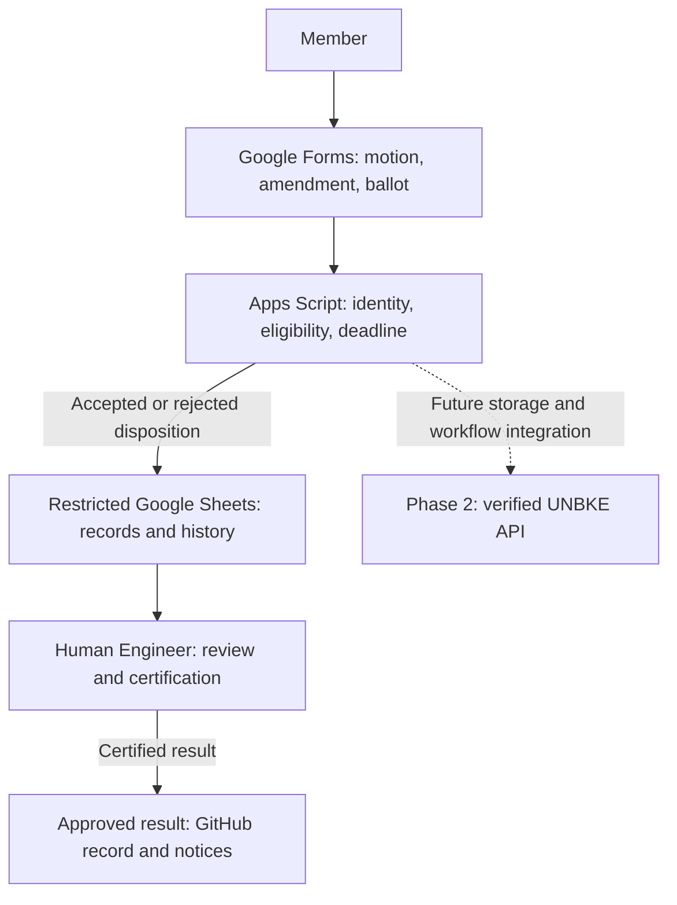

# RR-CE-DGM-0001 — Voting workflow

**Version:** 0.1  
**Status:** Draft — pending Human Engineer review  
**Date:** 2026-11-02  
**Owner:** Human Engineer; implementation steward unassigned  
**Scope:** Shared workflow; Kansas pilot proposed  
**Control:** [Chart storage and naming control](../../proposals/runtime-republic-chart-storage-control-draft.md)  
**Related:** [Jurisdiction and work board control](../../proposals/runtime-republic-work-board-control-draft.md)

## Diagram

## Text equivalent

A member submits a motion, amendment, or ballot through Google Forms. Apps Script validates identity, eligibility, and the recorded deadline, then writes an accepted or rejected disposition to restricted Google Sheets. The Human Engineer reviews evidence and certifies a result before its approved publication to GitHub or member notices. The dashed connection represents future integration through verified UNBKE API operations; it is not deployed functionality.

## Phase and authority boundaries

- Phase 1: Google Forms, restricted Sheets, and Apps Script are a proposed implementation, not installed services.
- Phase 2: UNBKE API integration follows capability verification and migration acceptance.
- Eligibility, motion revision, quorum, threshold, and ballot replacement rules are fixed before voting opens.
- A provisional tally is not certification. Certification does not itself confer legal or project authority absent the governing authorization.
- Private ballots and member details are not stored in this public diagram directory.
- This diagram documents the technical flow; adopted voting rules and procedure remain separate governing documents.

## Change history

| Version | Date | Change |
|---|---|---|
| 0.1 | 2026-11-02 | Initial proposed workflow, adapted from the conversation chart. |

BlueprintLiberty.com
