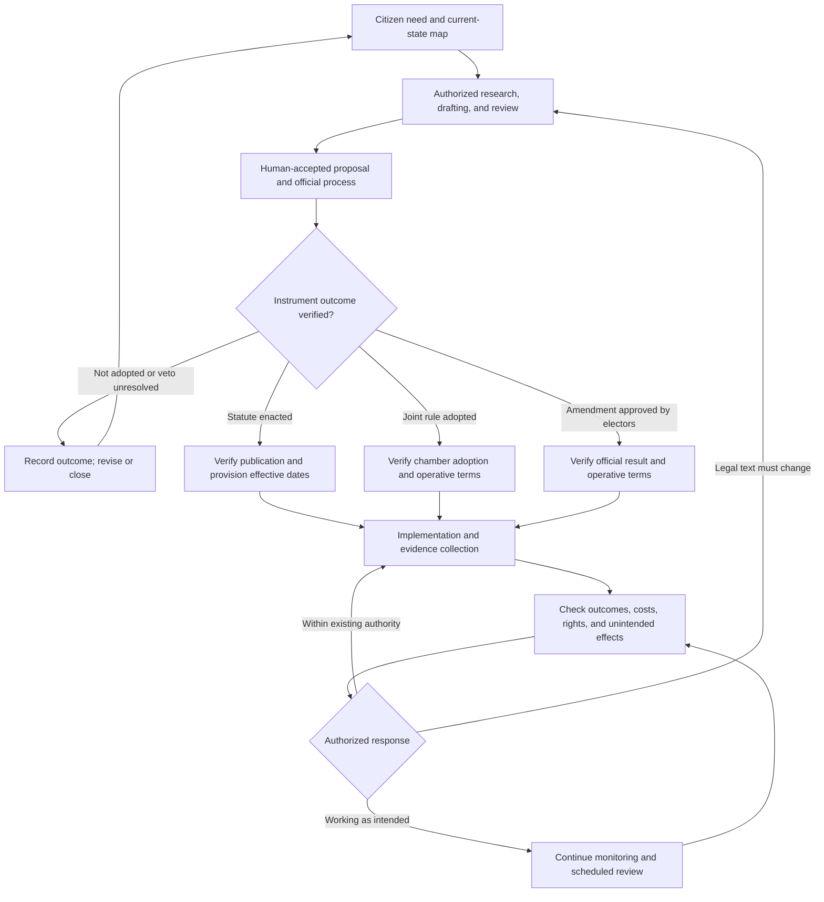

# RR-CE-DGM-0002 — Legislative lifecycle

**Version:** 0.1  
**Status:** Draft — pending Human Engineer review  
**Date:** 2026-11-02  
**Owner:** Human Engineer; implementation steward unassigned  
**Scope:** Shared model; Kansas PRJ-002 observation case  
**Governing proposal:** [Lifecycle and continuing statutory improvement control](../../proposals/runtime-republic-legislative-lifecycle-control-draft.md)

## Text equivalent and limits

Observe the citizen need; conduct authorized research, drafting, and review; follow the appropriate official process. Track non-adoption as well as adoption. Distinguish statute enactment/publication/effective dates, joint-rule adoption, and elector approval of constitutional amendments. After verified operative conditions, observe implementation and outcomes. Correct within actual authority or submit a new legal change through its own adoption process.

This is a proposed process, not evidence of an enacted instrument or deployed system. Internal review and improvement do not confer governmental authority. Consult the linked control for sources, instrument-specific routes, measurement rules, and legal boundaries.

## History

Version 0.1 — November 2, 2026: initial draft.

BlueprintLiberty.com
