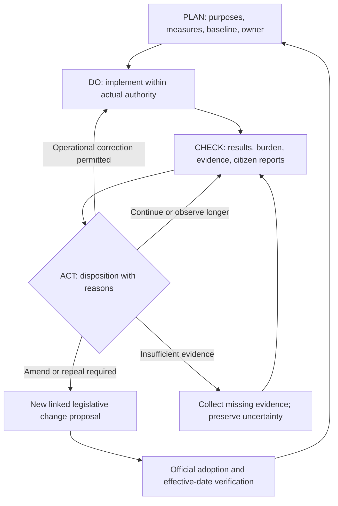

# RR-CE-DGM-0003 — Post-adoption PDCA

**Version:** 0.1  
**Status:** Draft — pending Human Engineer review  
**Date:** 2026-11-02  
**Owner:** Human Engineer; implementation steward unassigned  
**Scope:** Shared model; Kansas PRJ-002 observation case  
**Governing proposal:** [Lifecycle and continuing statutory improvement control](../../proposals/runtime-republic-legislative-lifecycle-control-draft.md)

## Text equivalent and limits

Plan evidence and measures, implement within authority, check outcomes and burdens, and record a reasoned decision. Correct operations only within current authority. Amendments or repeals return to legislative design and official adoption before creating a new operative baseline. Collect missing evidence without manufacturing success.

This is a proposed process, not evidence of an enacted instrument or deployed system. Internal review and improvement do not confer governmental authority. Consult the linked control for sources, instrument-specific routes, measurement rules, and legal boundaries.

## History

Version 0.1 — November 2, 2026: initial draft.

BlueprintLiberty.com
