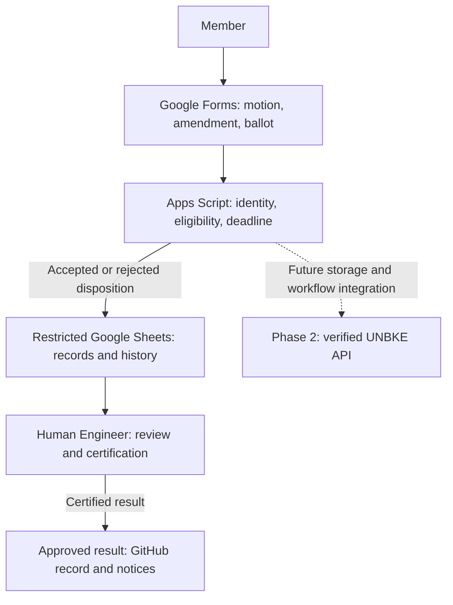

# Runtime Republic — Chart Storage, Naming, and Reference Control

**Status:** DRAFT — PENDING HUMAN ENGINEER REVIEW  
**Version:** 0.1  
**Date:** 2026-11-02  
**Formal control ID:** Unassigned; existing Engineering Office assignment process applies.  
**Proposed home:** Constitutional-Engineering  
**Approval authority:** Human Engineer

## 1. Purpose and authority

Make workflow and architecture charts discoverable, editable, reviewable, and traceable across RuntimeRepublic repositories. This draft establishes a proposed convention; storage, a pull request, a rendered diagram, or a merge does not by itself adopt the control or implement the process pictured. Higher governing documents and recorded approvals control where they differ from a chart.

## 2. Storage

Store charts in the repository responsible for the subject, under `docs/diagrams/`. Its `README.md` is the chart register. Shared Engineering Office workflow charts belong here; jurisdiction-specific or application charts belong with their responsible manager/application repository and are linked rather than copied.

Each editable diagram has one canonical Markdown file containing a fenced Mermaid block. Its surrounding metadata and prose travel with it. Optional image exports go in `docs/diagrams/exports/` and are explicitly derivatives. Do not create empty jurisdiction directories in advance. Do not store credentials, private rosters, ballots, or restricted screenshots in public repositories.

## 3. Naming and identity

Proposed ID format: `RR-<REPO-CODE>-DGM-<NNNN>`.

- `RR`: Runtime Republic.
- `REPO-CODE`: registered stable code for the owning repository; `CE` is proposed for Constitutional-Engineering.
- `DGM`: diagram.
- `NNNN`: four-digit sequence allocated in that repository's chart register; do not reuse retired IDs.
- Canonical filename: `<ID>-<lowercase-hyphenated-subject>.md`.
- Example: `RR-CE-DGM-0001-voting-workflow.md`.
- Revisions retain the ID and source filename. Version and date are metadata; Git records history.
- Derivative export: `<ID>-<subject>-v<major.minor.patch>.<png|svg>`, with the exact source commit recorded in the register or export manifest.
- Links to a fixed review baseline use a commit permalink; normal navigation uses relative links.
- Geography is metadata, not a changing component of the ID. Record country, jurisdiction/body, government target, participating team, and phase where relevant.
- Register additional repository codes before use; transfer of ownership requires an explicit old-to-new mapping and preserved references.

These proposed diagram IDs are content identifiers, not adopted Engineering Office control-document numbers. Concurrent allocations must be reconciled before merge.

## 4. Required metadata and register

Each diagram records ID, title, version, status, date, accountable owner/steward, scope, governing/related documents, and a change history. Unknown owners stay unassigned rather than invented. The register records those identifiers, canonical path, version, status, and available derivatives. No derivative may be presented as current without a known source revision.

Use Draft, Accepted, Superseded, or Retired diagram status with a linked human decision for acceptance or retirement. Acceptance of a diagram's accuracy is separate from authorization to implement its pictured system.

## 5. Authoring and accessibility

Use Mermaid in Markdown for editable workflow/topology charts; PNG for fixed-image distribution and SVG for scalable derivatives when needed. Keep labels readable, use top-down layout when width would become excessive, and provide a prose text equivalent. Label future/proposed connections explicitly; do not rely on color alone.

Do not use generated art for exact process diagrams. For quantitative charts, preserve source data, units, dates, assumptions, and reproducible generation instructions instead of guessing values.

## 6. References and embedded figures

The canonical chart is linked from other documents. When a control needs the chart inline, it may contain an identified embedded copy, labelled with diagram ID and version and linked to the canonical file. Any change to the canonical chart must update or explicitly retire all registered embedded copies in the same review package. Check that their Mermaid blocks match. Embedded copies do not become competing sources.

Registered embedded copy for this initial package: Section 8 of this control embeds RR-CE-DGM-0001 version 0.1.

## 7. Review, export, and maintenance

1. Check governing text, phase labels, authority boundaries, spelling, relative links, metadata, and register entries.
2. Check Mermaid syntax and open GitHub's Preview view to inspect rendering before acceptance; a successful upload alone does not prove a visual render.
3. Verify readable layout and text equivalent. Record any renderer limitation.
4. Review through a pull request under existing governance. Record human acceptance separately.
5. When exporting, render from the exact source revision and identify source commit, tool/version, export date, and dimensions. Never hand-edit an export without updating the source and regenerating.
6. Preserve superseded sources in Git history. Link replacements and fix affected references.

Exports are optional. This initial package provides editable Markdown, not a PNG/SVG export or automated renderer.

## 8. Worked example: Phase 1 Google workflow and Phase 2 UNBKE

**Embedded figure:** RR-CE-DGM-0001, version 0.1, Draft.  
**Canonical source:** [Voting workflow](../docs/diagrams/RR-CE-DGM-0001-voting-workflow.md).

A member submits through Google Forms. Apps Script validates the submission and records its disposition in restricted Sheets. The Human Engineer reviews and certifies the result before approved publication. The dashed edge shows future verified UNBKE API integration. All components describe a proposed system; this chart does not establish that scripts or services are deployed.

## 9. Initial acceptance checks

- Chart register links open the canonical example and this control.
- Canonical and embedded Mermaid blocks are identical.
- Google Sheets is Phase 1; the UNBKE API is Phase 2.
- Human certification precedes publication.
- Draft status and future dependency are explicit.
- No private member information appears.
- GitHub Preview renders without errors; human visual verification is recorded before acceptance.

## 10. References and revision history

GitHub rendering reference: https://docs.github.com/en/get-started/writing-on-github/working-with-advanced-formatting/creating-diagrams

This draft is subordinate to the existing Engineering Office hierarchy. Full compatibility review and formal document numbering remain pending.

| Version | Date | Change |
|---|---|---|
| 0.1 | 2026-11-02 | Initial chart convention, register, and embedded voting workflow example. |

BlueprintLiberty.com
