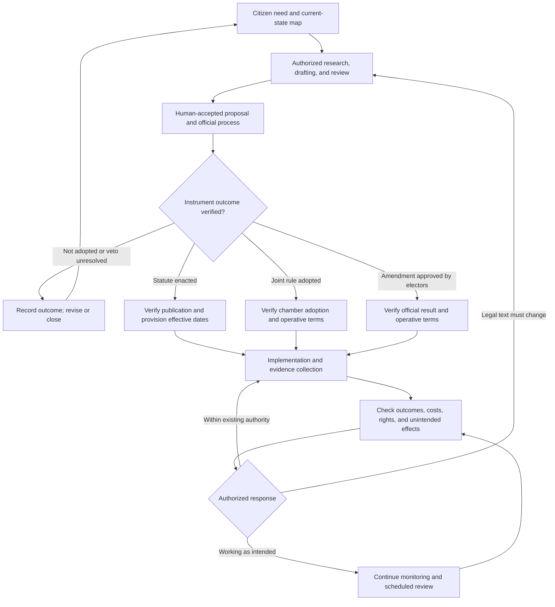
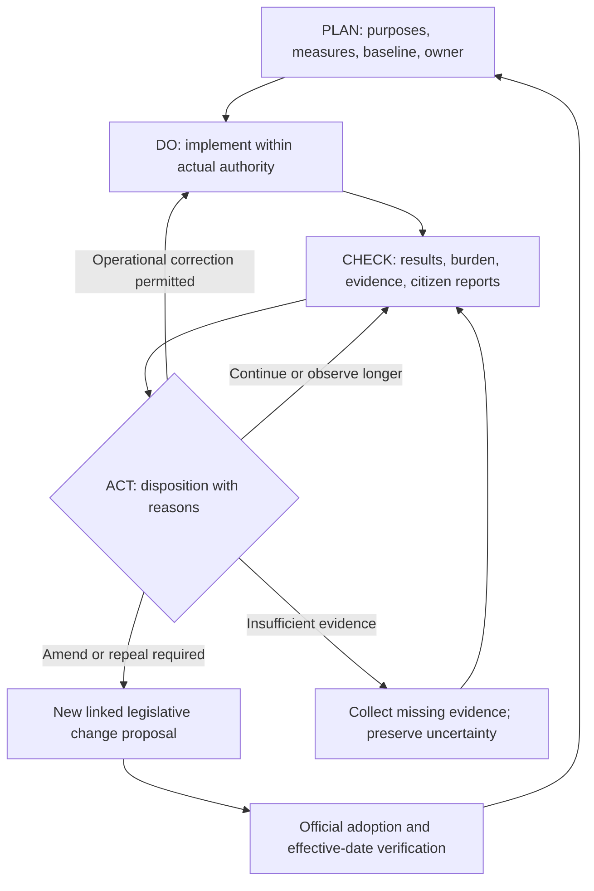

# Runtime Republic — Legislative Lifecycle and Continuing Statutory Improvement Control

**Status:** DRAFT — PENDING HUMAN ENGINEER REVIEW  
**Version:** 0.1  
**Date:** 2026-11-02  
**Formal control ID:** Unassigned; existing Engineering Office process applies.  
**Proposed governing home:** Constitutional-Engineering; implementation records belong to the responsible legislative manager.  
**Approval authority:** Human Engineer for internal project work; governmental decisions remain with the legally competent institutions.

## 1. Purpose and scope

Follow a proposal from citizen need through drafting, official disposition, implementation, evidence review, and lawful improvement. PRJ-002 is the first proposed observation case, not an enacted-law pilot. Its joint-rule, statutory, and constitutional tracks remain separate records with explicit dependencies.

This control is proposed. It neither authorizes drafting beyond existing work cards nor creates governmental review, enforcement, repeal, or sunset powers. It extends the lifecycle concept beyond a draft package; it does not imply any bill passed.

## 2. Lifecycle map

**Embedded figure:** RR-CE-DGM-0002 v0.1, Draft.  
[Canonical chart](../docs/diagrams/RR-CE-DGM-0002-legislative-lifecycle.md)

Text equivalent: observe the need, conduct authorized drafting and review, and submit an accepted proposal through the applicable official process. Record failure or non-adoption without inventing advancement. Statutes, joint rules, and constitutional amendments take distinct adoption paths. Verify the controlling text and operative dates before treating obligations as effective. Observe implementation and results; correct operations only within existing authority, or return proposed legal changes to the appropriate drafting and adoption process.

## 3. Preserve the legal milestones

For a statute, record chamber passage, final agreed text, governor action or other constitutionally permitted enactment route, official chapter/publication evidence, and each provision's effective date and conditions. A chamber vote, GitHub merge, or signature by itself does not establish that every provision is operative. Kansas Constitution Article 2 section 14 addresses governor consideration and veto routes; section 19 requires publication before an act takes effect. Verify the particular act rather than calculate its status from a generic chart.

For a constitutional amendment, track the applicable proposal, publication, submission to electors, official voting result, and operative provisions under Kansas Constitution Article 14. Legislative approval of a proposed amendment is not elector adoption. For a joint rule, verify the applicable chamber records, adoption procedure, operative terms, and session applicability rather than route it through a statute's governor/publication path.

Record veto, unresolved override, rejection, lapse, repeal, invalidation, injunction, delayed commencement, and partial effectiveness distinctly where evidenced. Official outcomes require official sources. Citizen reports may trigger investigation but cannot substitute for the legal record. The chart abbreviates these routes; it is not a complete legal-process specification.

## 4. Create a continuing law record at handoff

Keep a stable internal Law/Instrument ID independent of session bill numbers. Link proposal IDs, session/year, official bill number, instrument type, official text/version, chapter or resolution, affected code sections, enactment/adoption record, publication, provision-level dates, dependencies, and verified legal-status changes.

Preserve both the published act and current codified text when available, with amendment/repeal lineage. The project repository stores references and approved evidence packages; it does not replace the government's authoritative legal source. Each new legal revision links to its predecessor and its own official authority.

## 5. Plan the checks before implementation

For each material requirement, prepare a requirement-to-evidence row:

| Field | Required content |
|---|---|
| Requirement | Exact provision, version, purpose, responsible institution, and affected people. |
| Legal obligation | What the text actually requires; distinguish project aspirations and recommendations. |
| Measure | Definition, numerator/denominator if relevant, units, exclusions, source, collection interval, and observation period. |
| Baseline | Comparable pre-change evidence, or explicitly unknown; never invent a retrospective baseline. |
| Expected result | Predeclared criterion, uncertainty, adverse-effect guardrails, and review trigger. |
| Resources and burden | Public cost, implementation effort, citizen time, accessibility, and recurring record burden. |
| Ownership | Named internal evidence owner, verifier, and disposition authority; identify external responsibility without claiming delegation. |
| Review | Proposed internal dates, any legally required dates, evidence cutoff, and escalation route. |

Do not treat increased activity, more forms, money spent, or a dashboard's existence as the promised outcome.

## 6. Implementation readiness and monitoring

Check documented instructions, accountable roles, lawful resources, training, data access, accessibility, security, and start conditions. Record readiness gaps, actual start, implementation deviations, and source evidence. Funding and legal authority remain separate.

An implementation defect may differ from a defective statute. Classify findings as: administrative execution gap; ambiguous legal text; missing authority; resource constraint; data gap; changed external conditions; or unintended effect. A hypothesis about the cause stays labelled until examined.

## 7. Check and Act cycle

**Embedded figure:** RR-CE-DGM-0003 v0.1, Draft.  
[Canonical chart](../docs/diagrams/RR-CE-DGM-0003-post-enactment-pdca.md)

Text equivalent: plan the measures and responsibilities, implement within actual authority, compare observed results with expectations, and record a reasoned disposition. Permitted operational corrections return to implementation. Changes to law enter a linked legislative proposal and must complete their own official process before becoming a new operative baseline. Missing evidence prompts collection and an explicit uncertain finding, not a success claim.

Check compliance, delivered results, costs, taxpayer burden, access, rights impacts, distribution of effects, and unintended consequences. Record comparison limitations and alternative causes; a before-and-after change alone does not establish causation.

Act may mean: continue monitoring; seek missing evidence; correct a process within existing authority; revise training; refer a legal question; propose amendment, repeal, consolidation, or a lawful sunset; or escalate an urgent problem to the competent authority. For each disposition record the evidence, rationale, owner, authority, due date, and follow-up check.

Failure of a project measure does not automatically suspend a law, halt legally required services, or establish repeal. Existing lawful obligations continue unless altered by competent authority. Urgent issues follow applicable duties rather than waiting for a routine meeting.

## 8. Keep improving the statutes

Open one canonical finding for an observed problem. Link it to the exact provision and evidence. Record affected groups, desired outcome, alternative explanations, and the smallest candidate correction.

If correction requires legal change, open a linked change proposal with alternatives, definitions and cross-reference impacts, fiscal/resource consequences, transition and effective-date analysis, and review criteria. Obtain required internal authorization; draft and review under the existing standards; submit through the applicable official process.

A proposed change has its own lifecycle, and may fail. Do not overwrite the currently operative law with a proposed revision. After official adoption and commencement verification, establish the new version baseline and check whether the correction actually helped. Preserve unsuccessful proposals and negative findings as learning.

## 9. Review cadence

Adopt a proportionate internal calendar before the pilot. Suggested starting points: weekly review during active drafting/rollout, monthly evidence triage when activity warrants it, and four-month PDCA synthesis when adopted Lean Civics scope requires it. Align observation periods to outcomes; allow longer observations with interim checks. These are proposed internal practices, not mandated legislative sittings or enacted reporting obligations.

The current Lean Civics Control 05 is draft, not automatically binding. Record what is explicitly adopted. Combine reviews where appropriate; do not create meetings merely to fill a calendar. A missed review is overdue, not approval or reauthorization.

## 10. PRJ-002 proposed outcome checks

Subject to the eventual adopted text and definitions:

- Can a reviewer identify the exact legislative text version being considered?
- What elapsed time separates verified public availability and the specified official action?
- Can a material replacement be linked to the prior text and its own posting evidence?
- Are review comments sourced, addressed to a clause, and given a recorded disposition?
- What burden does compliance place on staff and citizens?
- Are there exceptions, inaccessible documents, missing timestamps, or conflicting official records?

Do not assume one hour is already a legal requirement. Fix what counts as publication, replacement, the relevant action, clock/timezone, exceptions, and observation evidence through the authorized design. A missing timestamp is unknown evidence, not an automatic violation. These checks concern procedure; they do not establish the substantive merits of a bill.

## 11. Phase 1 and Phase 2 records

Phase 1 uses proposed restricted Google Sheets/Forms/Apps Script for working records: Instruments, ProvisionVersions, RequirementsMeasures, Observations, Findings, Reviews, Decisions, and ChangeProposals. Reuse stable member, jurisdiction, motion, and task IDs where already defined. Public GitHub packages contain only approved public evidence and summaries, with sensitive data kept private.

Automations may collect evidence, flag anomalies, calculate provisional measures, and prepare review packages. They cannot enact law, certify legal compliance, approve changes, or grant authority. Record source retrieval time, provenance, errors, corrections, and coverage limits.

Phase 2 may migrate through verified UNBKE APIs after schema reconciliation, authorization checks, record-count/link validation, historical replay tests, and human acceptance. Preserve original events and evidence. Keep a rollback/export route. Do not double-count observations or treat import time as the original event date.

## 12. Pilot acceptance and authority boundaries

First observe the real draft lifecycle in PRJ-002. Post-adoption observations remain future work until there is an operative instrument. Simulation records must be explicitly labelled and excluded from live performance totals.

Before accepting the pilot, verify both embedded chart blocks match their canonical files, sources and dates are traceable, three instrument routes remain distinct, amendment loops require renewed lawful adoption, negative/missing evidence remains visible, private information is excluded, and no automation grants human acceptance. Establish numerical process targets before the experiment, not after seeing the results.

No changes to existing boards, legal texts, scripts, or adopted controls are authorized by this draft. Formal compatibility review, numbering, ownership and execution authorization remain pending.

## 13. Sources

Reviewed November 2, 2026:

- [Kansas Constitution Article 2](https://www.sos.ks.gov/publications/kansas-constitution/kansas-constitution-article-2.html), sections 14, 16, 19 and 20: enactment, amendment, publication, and bill boundaries.
- [Kansas Constitution Article 14](https://www.sos.ks.gov/publications/kansas-constitution/kansas-constitution-article-14.html): constitutional amendment proposal and elector approval.
- [Legislative Manager calendar](https://github.com/RuntimeRepublic/Legislative-Manager/blob/main/CALENDAR.md): PRJ-002 drafting schedule, not proof of outcomes.
- [Lean Civics Control 05](https://github.com/RuntimeRepublic/Lean-Civics-Control-Documents/blob/main/controls/05_PDCA_and_Controlled_Improvement.md): Draft 0.10; proposed PDCA practice, authority and cadence boundaries.
- [Jurisdiction/work board draft](runtime-republic-work-board-control-draft.md).
- [Chart storage/naming draft](runtime-republic-chart-storage-control-draft.md).

## Version history

| Version | Date | Change |
|---|---|---|
| 0.1 | 2026-11-02 | Initial complete lifecycle and post-adoption improvement proposal, with two embedded charts. |

BlueprintLiberty.com
